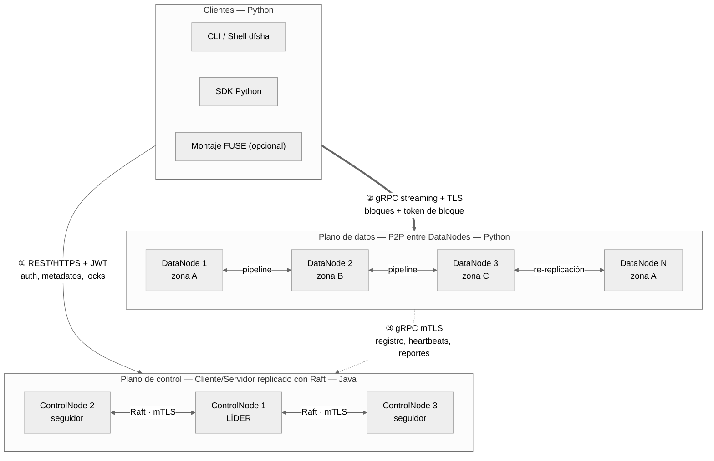
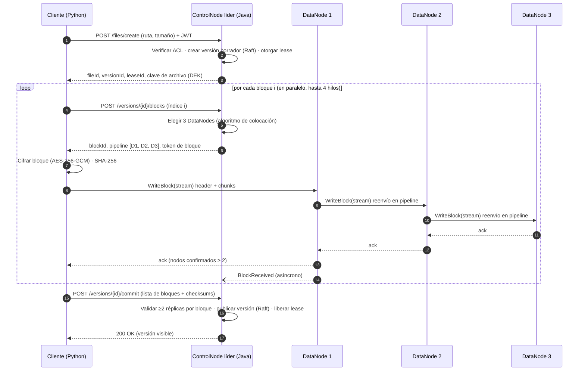
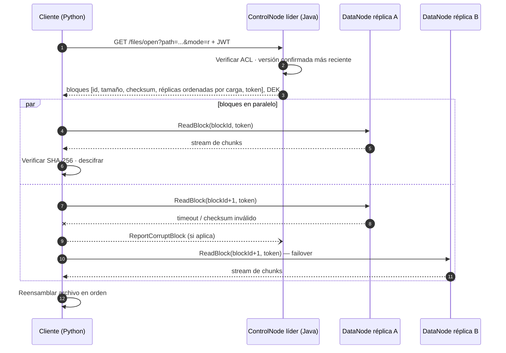
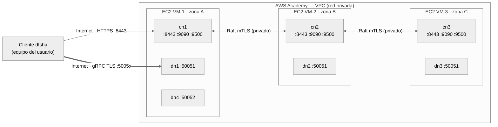

# DFSha — Especificación del Servicio (Hito 1)

**Proyecto 1: Sistema de archivos distribuido con alta disponibilidad, rendimiento y seguridad**
ST0263 Tópicos Especiales en Telemática / SI3007 Sistemas Distribuidos — 2026-2

| Campo | Valor |
|---|---|
| Repositorio | https://github.com/MiguelMontoya221004/DFSha |
| Integrantes | [Integrante 1] · [Integrante 2] · [Integrante 3] |
| Versión del documento | 1.0 — Hito 1 (Semana 1) |
| Arquitectura | Híbrida: plano de control Cliente/Servidor replicado + plano de datos P2P |
| Lenguajes | Java (ControlNode) · Python (DataNode y Cliente) |

---

## 1. Objetivo

Diseñar e implementar **DFSha**, un sistema de archivos distribuido **por bloques** que permita a usuarios autenticados almacenar, recuperar y acceder a archivos grandes repartidos en múltiples nodos que se comunican sobre Internet. El sistema debe ofrecer alta disponibilidad (sin punto único de falla), consistencia de datos y metadatos, rendimiento mediante lectura/escritura paralela, seguridad extremo a extremo y distintos niveles de transparencia para el cliente.

### 1.1 Objetivos específicos

1. Particionar cada archivo en bloques de tamaño fijo y distribuir cada bloque, con réplicas, entre varios DataNodes.
2. Mantener los metadatos en un clúster de 3 ControlNodes replicados con el algoritmo de consenso **Raft**.
3. Transferir datos directamente entre cliente y DataNodes, y replicar bloques entre DataNodes (modelo P2P), sin que los bytes pasen por el ControlNode.
4. Detectar fallos de nodos y recuperar automáticamente el factor de replicación.
5. Garantizar cifrado en tránsito (TLS/mTLS) y en reposo (AES-256-GCM), autenticación (usuario/contraseña, 2FA, API keys) y autorización (ACL).
6. Desplegar el sistema en contenedores Docker sobre máquinas virtuales de AWS Academy.

## 2. Marco teórico breve

**Sistema de archivos distribuido (DFS).** Permite compartir y acceder concurrentemente a archivos almacenados en diferentes nodos, ocultando (en mayor o menor grado) su ubicación física. Ejemplos clásicos: NFS, AFS y SMB/CIFS.

**DFS por bloques vs. por objetos.** En un DFS por bloques la unidad de lectura/escritura es el bloque y los bloques de un archivo se reparten en varios nodos, lo que permite acceso aleatorio y paralelismo. En un DFS por objetos (p. ej. AWS S3) la unidad es el archivo completo, se accede de forma secuencial mediante un SDK/API y no se permiten actualizaciones parciales (enfoque WORM). **DFSha adopta el modelo por bloques**, pero con semántica de escritura basada en versiones, que simplifica la consistencia.

**Google File System (GFS) y HDFS.** Arquitectura maestro–trabajadores: un nodo maestro (Master/NameNode) guarda el espacio de nombres y la ubicación de los bloques (*chunks*), y muchos nodos de datos (ChunkServers/DataNodes) almacenan los bloques con replicación (típicamente 3 copias). El cliente consulta metadatos al maestro y transfiere los datos directamente con los nodos de datos; la replicación se hace en *pipeline* entre nodos de datos. DFSha toma estas ideas y elimina el punto único de falla del maestro replicándolo con Raft.

**Raft.** Algoritmo de consenso que mantiene un log replicado en un grupo de servidores mediante elección de líder y replicación de entradas por mayoría. Con 3 nodos tolera la caída de 1 sin perder disponibilidad ni consistencia. Se usará la implementación **Apache Ratis** (Java).

**Arquitecturas híbridas C/S + P2P.** Combinan un componente centralizado para funciones que requieren una autoridad única (autenticación, metadatos, consistencia) con interacción directa entre pares para el tráfico masivo de datos, obteniendo control y escalabilidad a la vez (p. ej. BitTorrent con *tracker*, GFS/HDFS).

## 3. Descripción del servicio

### 3.1 Problema abordado

Almacenar archivos de gran tamaño en un único servidor limita la capacidad, el rendimiento y la disponibilidad: si el servidor falla, los datos quedan inaccesibles o se pierden. DFSha reparte los archivos en bloques replicados sobre muchos nodos, de modo que la capacidad y el ancho de banda crecen al agregar nodos y la caída de un nodo no interrumpe el servicio ni provoca pérdida de datos.

### 3.2 Modelo del servicio

- **Espacio de nombres jerárquico tipo Linux**, con raíz `/` y un directorio personal por usuario (`/home/<usuario>`).
- **Archivos divididos en bloques** de tamaño fijo (por defecto 4 MiB, configurable), cada uno con **3 réplicas** en DataNodes de máquinas distintas.
- **Versionamiento de archivos (copy-on-write):** cada escritura genera una nueva versión del archivo; los bloques modificados se escriben como bloques nuevos y la versión se publica de forma atómica al cerrar (`close`). Los lectores siempre ven una versión completa y confirmada.
- **Dos tipos de servicio sobre la misma base:**
  - **Transferencia** (`put`/`send`, `get`/`receive`): archivo completo, con bloques en paralelo.
  - **Acceso** (`open`, `read`, `write`, `seek`, `lock`, `close`): lectura aleatoria por desplazamiento y escritura parcial mediante copy-on-write.
- **Multiusuario** con autenticación y control de acceso por usuario y grupo.

### 3.3 Actores

| Actor | Descripción |
|---|---|
| Usuario | Persona que usa el CLI/shell o una aplicación que usa el SDK de DFSha. |
| Administrador | Usuario con rol `admin`: gestiona usuarios, grupos y consulta el estado del clúster. |
| ControlNode | Servicio de metadatos, autenticación y coordinación (3 instancias). |
| DataNode | Servicio de almacenamiento de bloques (N instancias). |

### 3.4 Alcance

**Incluido:** operaciones de gestión del sistema de archivos, transferencia y acceso; replicación y recuperación ante fallos; clúster de metadatos con Raft; seguridad (TLS/mTLS, cifrado en reposo, ACL, 2FA, API keys); despliegue Docker en AWS Academy; pruebas funcionales, de fallos y de rendimiento.

**Opcional (si el tiempo lo permite):** montaje FUSE para transparencia 100 %, rebalanceo automático al agregar DataNodes, cuotas por usuario, papelera de reciclaje.

**Fuera de alcance:** federación entre organizaciones, compresión/deduplicación, integración nativa con el sistema operativo Windows.

## 4. Requisitos funcionales

### RF1 — Gestión del sistema de archivos

| ID | Requisito | Comando CLI | Prioridad |
|---|---|---|---|
| RF1.1 | Listar contenido de un directorio (nombre, tipo, tamaño, dueño, permisos, fecha) | `ls [-l] [ruta]` | Alta |
| RF1.2 | Cambiar el directorio de trabajo y mostrar el actual | `cd <ruta>`, `pwd` | Alta |
| RF1.3 | Crear directorios, incluyendo intermedios | `mkdir [-p] <ruta>` | Alta |
| RF1.4 | Eliminar directorios vacíos o recursivamente | `rmdir <ruta>`, `rm -r <ruta>` | Alta |
| RF1.5 | Eliminar archivos (los bloques se liberan de forma diferida) | `rm <ruta>` | Alta |
| RF1.6 | Mover/renombrar archivos y directorios (operación atómica de metadatos) | `mv <origen> <destino>` | Media |
| RF1.7 | Consultar metadatos: tamaño, bloques, réplicas, versión | `stat <ruta>` | Media |
| RF1.8 | Gestionar permisos y ACL | `chmod`, `chown`, `setfacl`, `getfacl` | Alta |

### RF2 — Transferencia de archivos

| ID | Requisito | Comando / API | Prioridad |
|---|---|---|---|
| RF2.1 | Subir un archivo local: dividir en bloques, cifrar y enviar en paralelo a los DataNodes | `put <local> [remoto]` · `send()` | Alta |
| RF2.2 | Descargar un archivo: obtener bloques en paralelo desde réplicas, verificar y reconstruir | `get <remoto> [local]` · `receive()` | Alta |
| RF2.3 | Sobrescribir un archivo existente creando una nueva versión | `put -f` | Media |
| RF2.4 | Mostrar progreso y velocidad de transferencia | barra de progreso en CLI | Baja |
| RF2.5 | Reintentar automáticamente con otra réplica/nodo si una transferencia falla | automático | Alta |

### RF3 — Acceso a archivos

| ID | Requisito | API (SDK) | Prioridad |
|---|---|---|---|
| RF3.1 | Abrir un archivo en modo lectura, escritura o *append* | `open(path, mode)` → `FileHandle` | Alta |
| RF3.2 | Leer `n` bytes desde la posición actual (acceso aleatorio por bloque) | `read(n)`, `seek(offset)` | Alta |
| RF3.3 | Escribir bytes en una posición (copy-on-write de los bloques afectados) | `write(data)` | Alta |
| RF3.4 | Confirmar los cambios como nueva versión atómica y liberar recursos | `close()` | Alta |
| RF3.5 | Bloqueo compartido (lectura) o exclusivo (escritura) con expiración (*lease*) | `lock(mode, ttl)`, `unlock()` | Alta |
| RF3.6 | Consultar versiones disponibles de un archivo | `versions(path)` | Baja |

### RF4 — Usuarios y seguridad

| ID | Requisito | Prioridad |
|---|---|---|
| RF4.1 | Registro e inicio de sesión con usuario y contraseña | Alta |
| RF4.2 | Segundo factor de autenticación TOTP (Google Authenticator o similar) | Media |
| RF4.3 | Creación y revocación de API keys para uso programático | Media |
| RF4.4 | Gestión de grupos y pertenencia de usuarios (admin) | Media |
| RF4.5 | Cada usuario solo accede a los archivos permitidos por las ACL | Alta |

### RF5 — Administración y monitoreo

| ID | Requisito | Prioridad |
|---|---|---|
| RF5.1 | Consultar estado del clúster: líder Raft, ControlNodes y DataNodes vivos, capacidad usada/libre | Alta |
| RF5.2 | Consultar bloques con réplicas insuficientes y progreso de re-replicación | Media |
| RF5.3 | Endpoint de salud (`/health`) en cada nodo | Alta |

## 5. Requisitos no funcionales

| ID | Requisito | Decisión de diseño en DFSha | Cómo se verifica |
|---|---|---|---|
| RNF1 | Escalabilidad (usuarios, archivos, tamaño) | Plano de datos horizontal: agregar DataNodes aumenta capacidad y ancho de banda. Los bytes no pasan por el ControlNode. Metadatos compactos en memoria. Archivos de tamaño ilimitado (n bloques). | Throughput de `put`/`get` al pasar de 3 a 6 DataNodes; archivos de 1 MB a 1 GB. |
| RNF2 | Alta disponibilidad | 3 ControlNodes con Raft (tolera 1 caída). Factor de replicación 3 en máquinas/zonas distintas. Heartbeats y re-replicación automática. Cliente con reintentos y *failover*. | Detener el líder del ControlNode y un DataNode durante una transferencia: la operación termina correctamente. |
| RNF3 | Consistencia | Metadatos linealizables (Raft). Escritura con quórum mínimo 2/3 réplicas. Versiones inmutables publicadas atómicamente. Locks con *lease*. Checksums SHA-256 por bloque. | Pruebas de escritores concurrentes; lectura durante escritura; corrupción simulada de un bloque. |
| RNF4 | Particionamiento | Bloques fijos de 4 MiB; algoritmo de colocación que distribuye bloques de un mismo archivo y sus réplicas en distintos nodos. | `stat` muestra bloques de un archivo repartidos en varios DataNodes. |
| RNF5 | Rendimiento y concurrencia | Transferencia paralela de bloques (pool de 4–8 hilos). gRPC streaming con chunks de 1 MiB. Lecturas desde la réplica menos cargada. Múltiples lectores concurrentes por archivo (MVCC). | Medición MB/s vs número de hilos y de clientes simultáneos. |
| RNF6 | Seguridad | TLS 1.3 cliente–nodos; mTLS entre nodos con CA propia. Cifrado en reposo AES-256-GCM (del lado del cliente, clave por archivo). bcrypt + JWT + TOTP + API keys. ACL tipo POSIX. Tokens de bloque firmados (HMAC) y con expiración. | Captura de tráfico cifrado; bloques ilegibles en disco; accesos no autorizados rechazados (401/403). |
| RNF7 | Transparencia | Nivel 1: SDK/API. Nivel 2: shell interactivo con `cd`, rutas relativas y ubicación de bloques oculta. Nivel 3 (opcional): montaje FUSE, acceso como carpeta local. Ubicación siempre dinámica (resuelta por el ControlNode). | Demostración de los tres niveles en el video. |
| RNF8 | Requisitos adicionales | Se incorporarán las aclaraciones o nuevos requisitos que defina el profesor. | — |

## 6. Arquitectura del sistema

### 6.1 Tipo de arquitectura

**Arquitectura híbrida Cliente/Servidor + P2P**, organizada en dos planos:

| Plano | Modelo | Qué contiene | Por qué ese modelo |
|---|---|---|---|
| **Control** | Cliente/Servidor con servidor replicado (maestro–trabajadores). 3 ControlNodes con Raft: 1 líder y 2 seguidores. | Espacio de nombres, ACL, usuarios, versiones, lista de bloques por archivo, locks, estado del clúster. | Autenticación, permisos y consistencia necesitan una autoridad única y orden total de operaciones. Raft elimina el punto único de falla. |
| **Datos** | P2P entre DataNodes (pares que se comunican directamente). | Bloques cifrados y sus checksums. | El volumen de datos escala horizontalmente. Replicación en *pipeline* y re-replicación entre pares sin cuello de botella central. |

Desde el cliente, el servicio se ve como un sistema **cliente/servidor** (API y CLI abiertos). Internamente, los servidores mantienen autonomía S–S: el control está replicado y los datos se mueven entre pares.



*Figura 1. Arquitectura general de DFSha.*

### 6.2 Componentes

#### Cliente DFSha (Python)
- **CLI y shell interactivo** (`dfsha shell`) con `cd`, rutas relativas, autocompletado e historial.
- **SDK** (`dfsha.Client`, `dfsha.FileHandle`) con `send/receive` y `open/read/write/seek/lock/close`.
- **Motor de transferencia:** divide en bloques, cifra (AES-256-GCM), calcula SHA-256 y transfiere bloques en paralelo con reintentos y *failover*.
- **Caché local de metadatos** con invalidación por versión.
- **Montaje FUSE** (opcional) para transparencia total.

#### ControlNode (Java, 3 instancias)
- **Servidor REST (HTTPS)** para clientes: autenticación, operaciones de espacio de nombres, apertura de archivos, locks.
- **Servidor gRPC (mTLS)** para DataNodes: registro, heartbeats, reportes de bloques.
- **Máquina de estados Raft (Apache Ratis):** cada modificación de metadatos es una entrada del log replicado; snapshots periódicos a disco.
- **Gestor de bloques:** mapa bloque → réplicas (estado blando reconstruido con heartbeats y reportes), algoritmo de colocación, cola de re-replicación y recolección de bloques huérfanos.
- **Seguridad:** usuarios (bcrypt), JWT, TOTP, API keys, ACL, firma de tokens de bloque y protección de claves de archivo.
- Los seguidores **redirigen** las escrituras al líder (HTTP 307 con la dirección del líder).

#### DataNode (Python, N instancias)
- **Servidor gRPC** con `WriteBlock` y `ReadBlock` en streaming.
- **Almacenamiento local:** un archivo por bloque (`/data/blocks/ab/cd/<blockId>.blk`) y metadatos (`.meta`: tamaño, SHA-256, versión).
- **Replicación en pipeline:** reenvía el stream al siguiente DataNode mientras escribe localmente.
- **Heartbeats** cada 3 s a los 3 ControlNodes con capacidad, espacio libre y transferencias activas. Recibe órdenes en la respuesta (replicar, borrar).
- **Reporte completo de bloques** al iniciar y cada 5 min; reporte incremental al recibir un bloque.
- **Verificación periódica** de checksums (*scrubbing*) para detectar corrupción silenciosa.

### 6.3 Alternativas evaluadas

| Alternativa | Ventajas | Desventajas | Decisión |
|---|---|---|---|
| C/S puro (un servidor hace todo) | Simple | Cuello de botella y punto único de falla | Descartada |
| Maestro único + DataNodes (HDFS clásico) | Simple, probado | El maestro es punto único de falla (incumple RNF2) | Base del diseño, mejorada con Raft |
| P2P estructurado puro (DHT, sin maestro) | Sin punto central, muy escalable | Consistencia, ACL y `ls`/`mv` jerárquico muy complejos; difícil en 6 semanas | Descartada |
| **Híbrido: control C/S replicado + datos P2P** | Consistencia fuerte en metadatos, escalabilidad en datos, sin punto único de falla | Mayor número de componentes; curva de Raft | **Seleccionada** |

## 7. Comunicaciones y protocolos

### 7.1 Resumen por pareja de componentes

| Comunicación | Protocolo | Seguridad | Tipo | Propósito |
|---|---|---|---|---|
| Cliente ↔ ControlNode | REST sobre HTTPS (JSON) | TLS 1.3 + JWT o API key | Síncrono | Autenticación, espacio de nombres, apertura/commit de archivos, locks, estado |
| Cliente ↔ DataNode | gRPC (HTTP/2) streaming | TLS 1.3 + token de bloque firmado | Síncrono, streaming | Escritura y lectura de bloques |
| ControlNode ↔ ControlNode | Raft (Apache Ratis sobre gRPC) | mTLS | Síncrono | Elección de líder y replicación del log de metadatos |
| DataNode → ControlNode | gRPC | mTLS | Periódico | Registro, heartbeats, reportes de bloques, bloques corruptos |
| ControlNode → DataNode | Respuesta del heartbeat (comandos) | mTLS | Asíncrono por *piggyback* | Órdenes de replicar o borrar bloques |
| DataNode ↔ DataNode | gRPC streaming | mTLS | Síncrono, streaming | Pipeline de replicación y re-replicación |

**Por qué REST para el control y gRPC para los datos:** REST es fácil de probar (curl/Postman), de documentar (OpenAPI) y de consumir desde cualquier lenguaje. gRPC con HTTP/2 y Protocol Buffers ofrece streaming binario eficiente para bloques de varios MB y genera código para Java y Python desde el mismo `.proto`, lo que asegura la interoperabilidad entre lenguajes. No se requiere un MOM (Kafka/RabbitMQ): la comunicación asíncrona ControlNode→DataNode se resuelve con comandos en la respuesta del heartbeat.

### 7.2 API REST del ControlNode (v1)

Base: `https://<controlnode>:8443/api/v1`. Autenticación: `Authorization: Bearer <JWT>` o `X-API-Key: <key>`. Errores con formato `{ "error": "<código>", "message": "..." }`.

| Método | Ruta | Descripción |
|---|---|---|
| POST | `/auth/register` | Registrar usuario |
| POST | `/auth/login` | Usuario/contraseña → JWT, o `mfa_required` con `challengeId` |
| POST | `/auth/mfa/verify` | Validar código TOTP → JWT |
| POST | `/auth/mfa/enroll` | Activar 2FA (retorna URI `otpauth://` para QR) |
| POST / GET / DELETE | `/apikeys`, `/apikeys/{id}` | Crear, listar y revocar API keys |
| GET | `/fs/list?path=` | `ls` |
| GET | `/fs/stat?path=` | `stat`: tamaño, versión, bloques y réplicas |
| POST | `/fs/mkdir` | `{ path, parents }` |
| DELETE | `/fs/delete?path=&recursive=` | `rm`, `rmdir` |
| POST | `/fs/move` | `{ src, dst }` |
| GET / PUT | `/fs/acl?path=` | `getfacl` / `setfacl` |
| POST | `/files/create` | `{ path, size, overwrite }` → `fileId`, `versionId`, `leaseId`, `dek` |
| POST | `/files/open` | `{ path, mode: r\|w\|a }` → versión, bloques, réplicas, tokens, `dek` |
| POST | `/versions/{versionId}/blocks` | Asignar bloque `{ index }` → `blockId`, pipeline, token |
| POST | `/versions/{versionId}/commit` | `{ blocks: [{ index, blockId, size, sha256 }] }` → publica versión |
| POST | `/versions/{versionId}/abort` | Descarta la versión borrador |
| POST | `/files/{fileId}/lock` | `{ mode: shared\|exclusive, ttlSeconds }` → `leaseId` |
| POST | `/locks/{leaseId}/renew` · DELETE `/locks/{leaseId}` | Renovar / liberar lock |
| GET | `/cluster/status` | Líder Raft, nodos, capacidad, bloques sub-replicados (admin) |
| GET | `/health` | Salud del nodo (también indica si es líder) |

### 7.3 Servicios gRPC (borrador de `proto/dfsha.proto`)

```protobuf
syntax = "proto3";
package dfsha.v1;
option java_package = "io.dfsha.proto";

// ---------- Cliente ↔ DataNode y DataNode ↔ DataNode ----------
service DataTransfer {
  rpc WriteBlock (stream WriteBlockRequest) returns (WriteBlockResponse);
  rpc ReadBlock  (ReadBlockRequest)         returns (stream BlockChunk);
}

message WriteBlockRequest {
  oneof payload {
    BlockHeader header = 1;   // primer mensaje del stream
    bytes       chunk  = 2;   // siguientes mensajes (≤ 1 MiB c/u)
  }
}
message BlockHeader {
  string block_id        = 1;
  string block_token     = 2;  // firmado por el ControlNode (HMAC-SHA256)
  repeated string pipeline = 3; // DataNodes restantes a los que reenviar
  int64  size            = 4;
  string sha256          = 5;
}
message WriteBlockResponse {
  bool   ok                 = 1;
  repeated string stored_on = 2;  // DataNodes que confirmaron
  string error              = 3;
}
message ReadBlockRequest {
  string block_id    = 1;
  string block_token = 2;
  int64  offset      = 3;
  int64  length      = 4;  // 0 = hasta el final del bloque
}
message BlockChunk { bytes data = 1; }

// ---------- DataNode → ControlNode ----------
service NodeControl {
  rpc Register      (RegisterRequest)     returns (RegisterResponse);
  rpc Heartbeat     (HeartbeatRequest)    returns (HeartbeatResponse);
  rpc BlockReport   (BlockReportRequest)  returns (Ack);
  rpc BlockReceived (BlockReceivedRequest) returns (Ack);
  rpc ReportCorrupt (CorruptBlockRequest) returns (Ack);
}

message RegisterRequest  { string node_id = 1; string address = 2; string zone = 3; int64 capacity_bytes = 4; }
message RegisterResponse { bool accepted = 1; int32 heartbeat_interval_ms = 2; }
message HeartbeatRequest {
  string node_id = 1; int64 used_bytes = 2; int64 free_bytes = 3; int32 active_transfers = 4;
}
message HeartbeatResponse { bool is_leader = 1; repeated Command commands = 2; }
message Command {
  oneof cmd {
    ReplicateCommand replicate = 1;  // copiar block_id a target (DataNode ↔ DataNode)
    DeleteCommand    delete    = 2;
  }
}
message ReplicateCommand { string block_id = 1; string target_address = 2; string block_token = 3; }
message DeleteCommand    { repeated string block_ids = 1; }
message BlockReportRequest   { string node_id = 1; repeated BlockInfo blocks = 2; }
message BlockReceivedRequest { string node_id = 1; BlockInfo block = 2; }
message CorruptBlockRequest  { string reporter = 1; string node_id = 2; string block_id = 3; }
message BlockInfo { string block_id = 1; int64 size = 2; string sha256 = 3; }
message Ack { bool ok = 1; }
```

La comunicación **ControlNode ↔ ControlNode** usa el protocolo interno de Apache Ratis. Las operaciones que viajan por el log de Raft son: `CreateUser`, `Mkdir`, `Delete`, `Move`, `SetAcl`, `CreateVersion`, `AllocateBlock`, `CommitVersion`, `AbortVersion`, `AcquireLock`, `ReleaseLock`, `CreateApiKey`.

### 7.4 Puertos

| Componente | Puerto | Protocolo | Exposición |
|---|---|---|---|
| ControlNode — API REST | 8443 | HTTPS | Internet (clientes) |
| ControlNode — gRPC DataNodes | 9090 | gRPC mTLS | Red privada |
| ControlNode — Raft | 9500 | Ratis gRPC mTLS | Red privada |
| DataNode — DataTransfer | 50051 (50052…) | gRPC TLS/mTLS | Internet (clientes) y red privada |

## 8. Algoritmos de particionamiento, distribución y consistencia

### 8.1 Particionamiento en bloques

- Tamaño de bloque fijo `B = 4 MiB` (configurable por clúster; en pruebas de rendimiento se compararán 1, 4 y 16 MiB).
- Un archivo de tamaño `S` se divide en `n = ⌈S / B⌉` bloques; el último puede ser menor.
- Cada bloque tiene un identificador global `blockId` (UUID v4) asignado por el ControlNode, un índice dentro de la versión y un checksum SHA-256 calculado sobre el contenido **cifrado**, lo que permite a los DataNodes verificar integridad sin conocer la clave.
- Los bloques se transmiten en *chunks* de 1 MiB dentro del stream gRPC, para limitar el uso de memoria.

### 8.2 Colocación de réplicas

Factor de replicación `R = 3`. Para cada bloque nuevo, el ControlNode líder:

1. Filtra DataNodes **vivos** con espacio libre ≥ 2·B.
2. Calcula un puntaje de carga: `score = 0.6·(usado/capacidad) + 0.4·(transferencias_activas / máx_transferencias)`.
3. Elige la **primera réplica** con la estrategia *power of two choices*: toma 2 candidatos al azar y se queda con el de menor puntaje. Esto reparte la carga sin coordinación costosa.
4. Elige la **segunda y tercera réplica** con el mismo método, pero exige que estén en **zonas (máquinas virtuales) distintas** a las ya elegidas. Si no hay zonas suficientes, se relaja a hosts distintos.
5. Ordena el pipeline para minimizar saltos (primero la réplica más cercana al cliente cuando se conoce su zona).

Así, los bloques de un mismo archivo quedan repartidos en varios nodos (RNF4) y la pérdida de una máquina completa no elimina todas las copias de ningún bloque (RNF2).

### 8.3 Escritura (`put` / `write` + `close`)



*Figura 2. Secuencia de escritura con pipeline de replicación.*

1. El cliente solicita crear el archivo. El líder verifica permisos de escritura en el directorio padre y crea una **versión borrador** (entrada Raft). También otorga un **lease exclusivo de escritura** (60 s, renovable) y retorna la clave de datos del archivo (DEK).
2. Por cada bloque, en paralelo (hasta 4 hilos), el cliente pide al líder la asignación del bloque (`blockId`, pipeline de 3 DataNodes y token de bloque).
3. El cliente cifra el bloque, calcula su SHA-256 y hace `WriteBlock` al primer DataNode. Cada DataNode escribe a un archivo temporal y reenvía el stream al siguiente.
4. Cada DataNode verifica el SHA-256, renombra el temporal a definitivo (escritura atómica local) y confirma hacia atrás. El primero responde al cliente con la lista de nodos que confirmaron.
5. **Quórum mínimo de escritura W = 2:** si confirman al menos 2 réplicas el bloque se acepta. La tercera la completa luego el proceso de re-replicación. Si confirma menos de 2, el cliente pide un nuevo pipeline para ese bloque (máximo 3 intentos).
6. Al terminar, el cliente hace `commit`. El líder verifica que todos los bloques tengan ≥ 2 réplicas reportadas y publica la versión de forma **atómica** (entrada Raft): la ruta pasa a apuntar a la nueva versión. Luego libera el lease.
7. Si el cliente muere, el lease expira, la versión borrador se aborta y sus bloques quedan como huérfanos para recolección.

**Escritura parcial (`write` en un desplazamiento):** se hace copy-on-write. La nueva versión reutiliza los `blockId` de los bloques no modificados. Para cada bloque afectado, el cliente lee el bloque original, aplica el cambio y lo sube como un bloque nuevo. Solo al `close()` se publica la versión.

### 8.4 Lectura (`get` / `open` + `read`)



*Figura 3. Secuencia de lectura paralela con failover.*

1. El cliente abre el archivo. El líder verifica permisos de lectura y responde con la **última versión confirmada**: lista de bloques, checksums, réplicas vivas ordenadas por puntaje de carga, tokens de bloque (válidos 10 min) y DEK.
2. El cliente descarga bloques en paralelo desde la réplica de menor carga. Para `read(n)` con `seek`, solo descarga los bloques que cubren el rango `[offset, offset+n)`.
3. Verifica el SHA-256 y descifra con AES-256-GCM, lo que también verifica la integridad con la etiqueta de autenticación.
4. Si hay timeout, error o checksum inválido, prueba la siguiente réplica y reporta el bloque corrupto al ControlNode.
5. Como las versiones son inmutables, **las lecturas no bloquean ni son bloqueadas** por escritores concurrentes (control de concurrencia multiversión, MVCC).

### 8.5 Detección de fallos y re-replicación

| Parámetro | Valor inicial |
|---|---|
| Intervalo de heartbeat DataNode → ControlNodes | 3 s |
| DataNode *sospechoso* (no recibe réplicas nuevas) | sin heartbeat por 10 s |
| DataNode *muerto* (se re-replican sus bloques) | sin heartbeat por 30 s |
| Timeout de elección Raft | 1–2 s (aleatorio) |
| Reporte completo de bloques | al iniciar y cada 5 min |

1. El líder mantiene para cada bloque el conjunto de réplicas vivas. Cuando un DataNode se declara muerto (o se reporta un bloque corrupto), los bloques afectados entran en una **cola de prioridad** ordenada por número de réplicas vivas (primero los que tienen 1 réplica).
2. Para cada bloque, el líder elige un DataNode origen que tenga una réplica sana y un destino (algoritmo 8.2). Luego envía un `ReplicateCommand` en la respuesta del siguiente heartbeat del origen.
3. El origen transfiere el bloque directamente al destino (**P2P**) con `WriteBlock`. El destino reporta `BlockReceived`.
4. Se limita a 2 re-replicaciones simultáneas por DataNode para no saturar la red.
5. Si un nodo "muerto" vuelve con réplicas de más, el líder ordena borrar las copias sobrantes.

**Fallo del ControlNode líder:** Raft elige un nuevo líder entre los 2 seguidores restantes (< 5 s). Como los DataNodes envían heartbeats y reportes a los 3 ControlNodes, los seguidores ya tienen el mapa de bloques actualizado y el nuevo líder atiende de inmediato. El cliente mantiene la lista de ControlNodes y reintenta contra otro nodo o sigue la redirección 307.

### 8.6 Modelo de consistencia

| Aspecto | Garantía | Mecanismo |
|---|---|---|
| Metadatos (namespace, ACL, versiones) | **Linealizable** | Todas las escrituras y lecturas de metadatos pasan por el líder Raft y se confirman con mayoría (2 de 3) |
| Contenido de un archivo | **Atomicidad por versión** (todo o nada) | Versiones inmutables + publicación atómica al `commit` |
| Escritores concurrentes | **Un solo escritor por archivo** | Lease exclusivo con expiración; un segundo escritor recibe `409 Conflict` o espera |
| Lectores concurrentes | **Lectura de la última versión confirmada** (*read-committed* por versión) | MVCC: los lectores fijan la versión al abrir |
| Réplicas de un bloque | **Idénticas** (inmutables) | Un bloque nunca se modifica después de escrito; SHA-256 + *scrubbing* |
| Durabilidad | Confirmada con ≥ 2 réplicas; converge a 3 | Quórum W = 2 + re-replicación en segundo plano |

**Recolección de basura:** cuando se borra un archivo o una versión queda obsoleta (se conservan las 2 últimas), sus bloques pasan a la lista de eliminación. El líder envía `DeleteCommand` a los DataNodes en los heartbeats. Los bloques huérfanos de escrituras abortadas se eliminan después de 1 hora.

### 8.7 Escalabilidad

- **Datos:** capacidad y throughput crecen linealmente con los DataNodes. Un DataNode nuevo se registra y empieza a recibir bloques de inmediato, porque su puntaje de carga es bajo.
- **Metadatos:** estructuras en memoria (≈ 200 bytes por archivo y ≈ 150 bytes por bloque). 1 GB de RAM alcanza para millones de bloques, más que suficiente para el alcance del proyecto.
- **Clientes:** el ControlNode solo atiende operaciones de metadatos (pequeñas). Las lecturas de metadatos que toleren datos ligeramente desactualizados (p. ej. `ls`) pueden servirse desde seguidores como mejora futura.

## 9. Seguridad

### 9.1 Cifrado en tránsito
- **Cliente → ControlNode:** HTTPS con TLS 1.3.
- **Cliente → DataNode:** gRPC sobre TLS 1.3.
- **Entre nodos (CN↔CN, CN↔DN, DN↔DN):** **mTLS**. Cada nodo tiene un certificado X.509 emitido por una **CA propia del clúster**, generada con un script (`scripts/gen-certs.sh`). Un nodo sin certificado válido de la CA no puede unirse al clúster ni replicar bloques.

### 9.2 Cifrado en reposo (cifrado de extremo a extremo)
- Cada archivo tiene una **clave de datos (DEK)** AES-256 aleatoria.
- La DEK se guarda en los metadatos **cifrada con la clave maestra del clúster (KEK)** (*envelope encryption*). La KEK se inyecta a los ControlNodes como *Docker secret* o variable de entorno y nunca se escribe en el log de Raft en claro.
- El **cliente cifra cada bloque** con AES-256-GCM (nonce de 96 bits único por bloque) antes de enviarlo. **Los DataNodes nunca ven datos en claro**, así que comprometer un DataNode no expone archivos.
- La DEK solo se entrega por TLS a usuarios con permiso de lectura o escritura sobre el archivo.

### 9.3 Autenticación
| Mecanismo | Implementación |
|---|---|
| Usuario/contraseña | Contraseñas almacenadas con **bcrypt** (costo 12) |
| Sesión | **JWT** firmado (HS256/RS256), expiración 1 h + refresh token |
| 2FA | **TOTP** (RFC 6238), compatible con Google Authenticator; obligatorio para administradores |
| API keys | Prefijo visible + secreto aleatorio de 32 bytes; se guarda solo su hash SHA-256; con fecha de expiración y revocables |
| Protección | Límite de intentos de login (5 por minuto) y bloqueo temporal |

### 9.4 Autorización (ACL)
- Modelo tipo **POSIX**: dueño, grupo y permisos `rwx` para dueño/grupo/otros, más **entradas ACL extendidas** (`user:ana:rw-`, `group:equipo1:r-x`).
- Semántica: `r` = leer archivo / listar directorio · `w` = escribir archivo / crear y borrar en directorio · `x` = atravesar directorio.
- Los directorios pueden tener **ACL por defecto**, que heredan los hijos al crearse.
- Permisos por defecto: `/home/<usuario>` con `rwx------` (cada usuario solo ve sus archivos); `/shared` para compartir entre grupos.
- El rol `admin` puede gestionar usuarios y grupos y consultar el clúster, pero **no puede leer el contenido** de archivos ajenos sin permiso ACL explícito.

### 9.5 Tokens de bloque
Los DataNodes no consultan la base de usuarios. El ControlNode emite **tokens de bloque** firmados con HMAC-SHA256 usando una clave compartida por el clúster (rotada periódicamente):

```
token = base64( blockId | userId | modo(r|w) | expiración ) + "." + HMAC(clave_cluster, payload)
```

El DataNode verifica firma, modo y expiración antes de leer o escribir. Así el control de acceso se aplica también en el plano de datos sin agregar latencia de consulta al ControlNode.

### 9.6 Auditoría
Registro de eventos de seguridad en el ControlNode (login exitoso/fallido, cambios de ACL, creación de API keys, accesos denegados) con usuario, IP y fecha.

## 10. Transparencia

| Nivel | Mecanismo | Qué oculta al usuario |
|---|---|---|
| 1 — API/SDK | `from dfsha import Client` · `client.open("/home/ana/log.txt").read()` | Bloques, réplicas, nodos, fallos y reintentos |
| 2 — Shell/CLI | `dfsha shell`: `cd`, `ls`, `put`, `get` con rutas relativas y directorio de trabajo | Además, las URLs y la API. Parece un shell de Linux |
| 3 — FUSE (opcional) | `dfsha mount /mnt/dfsha` y uso con `cp`, `cat`, editores | Todo: el DFS se ve como una carpeta local (100 % transparente) |

La **localización siempre es dinámica**: el cliente solo conoce las direcciones de los ControlNodes (configuración) y obtiene la ubicación de los bloques en cada apertura. Si un bloque se re-replica o un nodo cambia, el cliente se entera automáticamente.

## 11. Entorno de ejecución e infraestructura

### 11.1 Entorno local de desarrollo (Docker Compose)
- `docker-compose.yml` con **3 ControlNodes, 4 DataNodes y 1 contenedor cliente**, en una red bridge `dfsha-net`.
- Cada DataNode monta un volumen propio (`dn1-data`, …) para simular discos independientes. Cada ControlNode monta un volumen para el log y los snapshots de Raft.
- Certificados de la CA generados por script y montados como *secrets*.
- Pruebas de fallos: `docker stop cn1`, `docker stop dn2`, `docker network disconnect`.

### 11.2 Entorno en la nube (AWS Academy)



*Figura 4. Despliegue de referencia en AWS Academy.*

- **3 instancias EC2** (Ubuntu 24.04, t3.medium o la disponible en Learner Lab), una por zona de disponibilidad si el laboratorio lo permite. Cada una ejecuta 1 ControlNode y 1–2 DataNodes en Docker.
- **Elastic IPs** (o DNS público) para que el cliente acceda por Internet. Cada DataNode anuncia su dirección pública al registrarse.
- **Security Groups:** abiertos a Internet solo 8443 (REST) y 50051–50052 (gRPC datos). Puertos 9090 y 9500 solo dentro del Security Group del clúster.
- Scripts de despliegue (`deploy/aws/`) para reconstruir el entorno rápidamente, porque las sesiones de AWS Academy expiran.

### 11.3 Stack tecnológico

| Componente | Tecnología |
|---|---|
| ControlNode | Java 21 LTS, Spring Boot (REST + Spring Security), grpc-java, Apache Ratis 3.x (Raft), Maven |
| DataNode | Python 3.12, grpcio / grpcio-tools, asyncio, cryptography |
| Cliente | Python 3.12, Typer (CLI), prompt_toolkit (shell), httpx (REST), grpcio, cryptography, pyfuse3/fusepy (opcional) |
| Contratos | Protocol Buffers (`proto/dfsha.proto`), OpenAPI 3 para REST |
| Seguridad | TLS 1.3/mTLS (OpenSSL para la CA), bcrypt, JWT, TOTP |
| Infraestructura | Docker, Docker Compose, AWS Academy EC2 |
| Pruebas | JUnit 5 (Java), pytest (Python), scripts de carga y de inyección de fallos |
| Calidad / CI | GitHub Actions: compilación, generación de stubs y pruebas unitarias |

### 11.4 Estructura propuesta del repositorio

```
DFSha/
├── README.md                 # descripción, arquitectura, cómo ejecutar
├── docs/                     # especificación, informe, diagramas, OpenAPI
├── proto/dfsha.proto         # contrato gRPC compartido (Java + Python)
├── controlnode/              # Java · Maven · Spring Boot + Ratis
│   └── src/main/java/io/dfsha/controlnode/{api,raft,metadata,blocks,security}
├── datanode/                 # Python · servidor gRPC de bloques
│   └── dfsha_datanode/{server,storage,replication,heartbeat}.py
├── client/                   # Python · CLI, shell y SDK
│   └── dfsha/{client,filehandle,transfer,crypto,shell,cli}.py
├── deploy/
│   ├── docker-compose.yml
│   ├── certs/gen-certs.sh
│   └── aws/                  # scripts de despliegue EC2
├── tests/                    # integración, fallos y rendimiento
└── .github/workflows/ci.yml
```

## 12. Plan de pruebas

| Tipo | Caso | Resultado esperado |
|---|---|---|
| Funcional | `mkdir`, `put`, `ls`, `get`, `rm`, `mv` con archivos de 1 KB a 1 GB | Archivo descargado idéntico (SHA-256 igual al original) |
| Funcional | `open/seek/read` y `write` parcial + `close` | Solo cambian los bloques afectados; nueva versión visible |
| Particionamiento | `stat` de un archivo de 100 MB | 25 bloques repartidos en ≥ 3 DataNodes, 3 réplicas cada uno |
| Alta disponibilidad | Detener 1 DataNode durante `put` y `get` | La operación termina; en < 60 s todos los bloques vuelven a 3 réplicas |
| Alta disponibilidad | Detener el ControlNode líder | Nuevo líder en < 5 s; el cliente continúa sin intervención |
| Consistencia | 2 clientes escriben el mismo archivo a la vez | Uno obtiene el lease y el otro recibe `409`; no hay versiones mezcladas |
| Consistencia | Lectura mientras otro cliente escribe | El lector obtiene la versión anterior completa |
| Integridad | Corromper manualmente un `.blk` en disco | Se detecta por checksum, se lee de otra réplica y se re-replica |
| Seguridad | Acceso sin JWT, con JWT de otro usuario, con token de bloque expirado | `401` / `403` / rechazo en DataNode |
| Seguridad | Captura con `tcpdump`/Wireshark; inspección de `.blk` en disco | Tráfico TLS ilegible; bloques cifrados |
| Seguridad | Nodo sin certificado de la CA intenta registrarse | Conexión rechazada por mTLS |
| Rendimiento | Throughput (MB/s) de `put`/`get` variando hilos (1, 2, 4, 8), DataNodes (3, 4, 6) y tamaño de bloque (1, 4, 16 MiB) | Gráficas para el informe; mejora con paralelismo |
| Concurrencia | 10 clientes simultáneos haciendo `put`/`get` | Sin errores; latencia de metadatos p95 medida |

## 13. Plan de trabajo

### 13.1 Cronograma por hitos

| Semana | Hito | Entregables |
|---|---|---|
| 1 | **Hito 1 — Especificación** | Este documento · `dfsha.proto` v0 · esqueleto del repo · Docker Compose "hola mundo" (los 3 componentes se comunican) |
| 2 | Hito 2 (parte 1) | ControlNode de un solo nodo: namespace, usuarios básicos, REST. DataNode: `WriteBlock`/`ReadBlock` en disco. Cliente: `put`/`get`/`ls`/`mkdir`/`rm` sin replicación |
| 3 | **Hito 2 — Arquitectura distribuida y comunicaciones** | Heartbeats, registro, colocación de réplicas, pipeline de replicación, lectura paralela, TLS. Primer despliegue en AWS |
| 4 | Hito 3 (parte 1) | Clúster de 3 ControlNodes con Ratis, failover del líder, re-replicación, leases/locks, versiones y copy-on-write |
| 5 | **Hito 3 — HA, replicación, consistencia, seguridad** | mTLS con CA propia, tokens de bloque, ACL, 2FA, API keys, cifrado de extremo a extremo, pruebas de fallos |
| 6 | **Hito 4 — Entrega final** | Pruebas de rendimiento, informe técnico, README reproducible, video de 10–15 min. Opcional: FUSE |

### 13.2 Reparto de responsabilidades (3 integrantes)

| Integrante | Rol principal | Responsabilidades |
|---|---|---|
| **Integrante 1** | ControlNode (Java) | API REST, modelo de metadatos y namespace, Apache Ratis (Raft), colocación de réplicas y re-replicación, usuarios/ACL/JWT/2FA, tokens de bloque |
| **Integrante 2** | DataNode (Python) | Servidor gRPC de bloques, almacenamiento local, pipeline de replicación, heartbeats y reportes, ejecución de comandos, *scrubbing*, mTLS entre nodos |
| **Integrante 3** | Cliente (Python) + infraestructura | CLI/shell/SDK, transferencia paralela, cifrado AES-GCM del lado del cliente, Docker Compose, CA/certificados, despliegue AWS, pruebas de rendimiento y fallos |
| **Todos** | Compartido | Contrato `dfsha.proto` y OpenAPI (semana 1), revisión de código por Pull Requests, informe técnico y video |

**Flujo de trabajo en GitHub:** rama `main` protegida, ramas `feature/<componente>-<tarea>`, Pull Requests con revisión de al menos un compañero, *issues* por tarea en un tablero de GitHub Projects y etiquetas por hito.

## 14. Riesgos y mitigaciones

| Riesgo | Impacto | Mitigación |
|---|---|---|
| Curva de aprendizaje de Apache Ratis | Alto | Prototipo de Ratis en la semana 2, en paralelo; el ControlNode se diseña detrás de una interfaz `MetadataStore`. Plan B: réplica primario–respaldo con log replicado y elección simple de líder |
| Interoperabilidad Java ↔ Python | Medio | Contratos (`.proto` + OpenAPI) definidos en la semana 1; generación de stubs automatizada en CI; pruebas de integración en Docker Compose desde la semana 2 |
| Rendimiento de Python en DataNodes | Medio | Streaming por chunks de 1 MiB, asyncio, sin copias innecesarias; medir temprano |
| Límites de AWS Academy (sesiones que expiran, IPs cambiantes) | Medio | Todo reproducible con Docker Compose y scripts; Elastic IPs; demo local de respaldo |
| Alcance demasiado grande para 6 semanas | Alto | Priorizar requisitos de prioridad Alta; FUSE, rebalanceo y cuotas son opcionales |
| Manejo de certificados y claves | Medio | Script único de generación de CA y certificados; secretos fuera del repositorio (`.gitignore`) |

## 15. Referencias

1. S. Ghemawat, H. Gobioff y S.-T. Leung, "The Google File System", *ACM SOSP*, 2003.
2. K. Shvachko, H. Kuang, S. Radia y R. Chansler, "The Hadoop Distributed File System", *IEEE MSST*, 2010.
3. D. Ongaro y J. Ousterhout, "In Search of an Understandable Consensus Algorithm (Raft)", *USENIX ATC*, 2014.
4. Apache Ratis — https://ratis.apache.org/
5. gRPC — https://grpc.io/ · Protocol Buffers — https://protobuf.dev/
6. M. Mitzenmacher, "The Power of Two Choices in Randomized Load Balancing", *IEEE TPDS*, 2001.
7. RFC 6238 — TOTP: Time-Based One-Time Password Algorithm.
8. Enunciado ST0263-SI3007 2026-2, Proyecto 1: DFSha.
