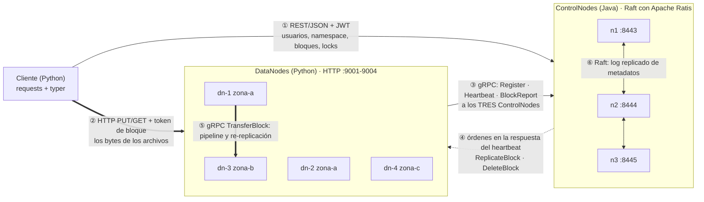
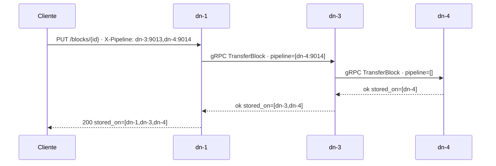
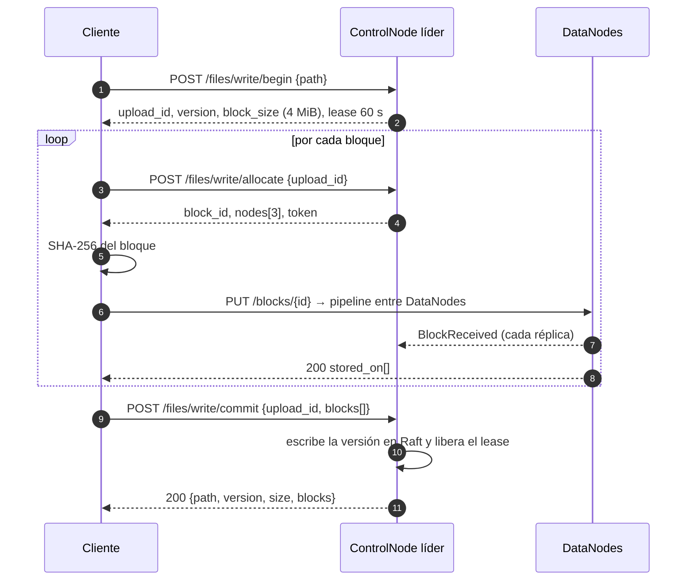
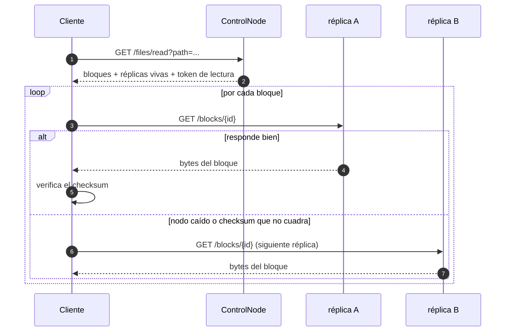
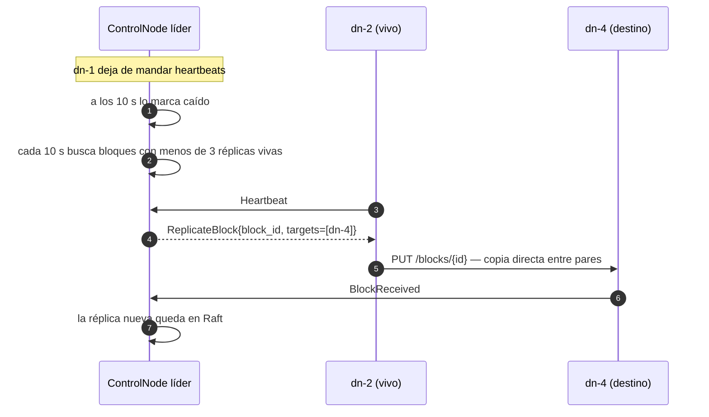

# DFSha — Especificación de comunicaciones

ST0263 / SI3007 · 2026-2 · versión 1.0 (sistema integrado)

Este documento define **cómo se hablan las tres piezas de DFSha**: protocolos, mensajes,
puertos, tiempos, reintentos y errores. Es el contrato que implementan el ControlNode
(Java), el DataNode (Python) y el Cliente (Python).

Fuentes de verdad del contrato:

| Contrato | Archivo |
|---|---|
| REST del ControlNode (metadatos, usuarios, locks) | [`controlnode/README.md`](../controlnode/README.md) |
| gRPC ControlNode ↔ DataNode | [`controlnode/src/dfsha.proto`](../controlnode/src/dfsha.proto) |
| HTTP del DataNode (bloques) | [`docs/api-datanode.md`](api-datanode.md) |

## 1. Vista general



Dos principios que explican todo lo demás:

- **El ControlNode nunca transporta datos.** Solo entrega metadatos, decide dónde van los
  bloques y firma tokens. De ahí salen la escalabilidad (RNF1) y el rendimiento (RNF5).
- **El ControlNode nunca abre conexiones hacia los DataNodes.** Todo lo inicia el DataNode
  y las órdenes vuelven dentro de la respuesta del heartbeat. Evita problemas de NAT y de
  security groups en AWS, y es como lo hace HDFS.

## 2. Matriz de comunicaciones

| # | Comunicación | Protocolo | Formato | Quién inicia | Puerto | Seguridad hoy | Pendiente |
|---|---|---|---|---|---|---|---|
| ① | Cliente → ControlNode | HTTP/1.1 REST | JSON | Cliente | 8443-8445 | JWT (HS256) + permisos POSIX | TLS 1.3 |
| ② | Cliente ↔ DataNode | HTTP/1.1 (`PUT`/`GET`) | Bytes crudos, por trozos | Cliente | 9001-9004 | Token de bloque HMAC-SHA256 | TLS 1.3 |
| ③ | DataNode → ControlNode | gRPC (HTTP/2) | Protobuf | DataNode | 50051-50053 | Red privada | mTLS con la CA del proyecto |
| ④ | ControlNode → DataNode | Dentro de la respuesta de ③ | Protobuf | ControlNode responde | 50051-50053 | Idem ③ | Idem ③ |
| ⑤ | DataNode ↔ DataNode | gRPC (`DataNodeService.TransferBlock`) | Protobuf, bloque completo | DataNode | 9011-9014 (`peer_port`) | Token de bloque | mTLS + token · pasar a streaming |
| ⑥ | ControlNode ↔ ControlNode | Raft (Apache Ratis sobre gRPC) | Protobuf | Líder/candidato | 9501-9503 | Red privada | mTLS |

### Por qué cada protocolo

| Decisión | Razón | Alternativa descartada |
|---|---|---|
| REST/JSON para el cliente | Se prueba con `curl`, se lee en el navegador y el cliente se escribe con `requests` y nada más. Los mensajes son pequeños | gRPC para el cliente: obliga a generar stubs para transportar metadatos de unos pocos KB |
| HTTP para los bloques | El cuerpo de un `PUT` ya es un stream: se manda un bloque de 4 MiB en trozos de 1 MiB sin cargarlo en memoria, y `Range` da la lectura por rangos gratis | gRPC streaming: más eficiente en el formato, pero el cliente tendría que depender de `grpcio` solo para mover bytes |
| gRPC entre ControlNode y DataNodes | Ahí sí hay mensajes con estructura (heartbeats, reportes, órdenes) y un contrato tipado evita que Java y Python se desincronicen | REST también para los heartbeats: más serialización a mano en los dos lados |
| Órdenes dentro del heartbeat | El ControlNode no necesita alcanzar al DataNode ni mantener conexiones abiertas | Conexión persistente o una cola de mensajes por nodo |
| Sin broker (Kafka/RabbitMQ) | La única comunicación asíncrona son las órdenes, y el heartbeat ya da un canal periódico. Un broker sería otro componente al que habría que hacerle alta disponibilidad | Kafka para eventos de bloque |

## 3. ① Cliente ↔ ControlNode (REST)

Todo lo que no sea `/auth/*`, `/health`, `/cluster` o `/datanodes/*` necesita
`Authorization: Bearer <jwt>`. La lista completa está en el README del ControlNode; lo
esencial:

| Método | Ruta | Para qué |
|---|---|---|
| POST | `/auth/register` · `/auth/login` | Crear usuario (con su `/home/<usuario>`) y obtener el JWT |
| GET | `/fs/ls?path=` · `/fs/stat?path=` | Listar y ver metadatos |
| POST | `/fs/mkdir` · `/fs/mv` · `/fs/chmod` | Crear, mover, permisos |
| DELETE | `/fs/rm?path=` · `/fs/rmdir?path=` | Borrar |
| POST | `/files/write/begin` | Abre la escritura: devuelve `upload_id`, `version`, `block_size` y toma el lease |
| POST | `/files/write/allocate` | Por cada bloque: `block_id`, los 3 DataNodes y el `token` |
| POST | `/files/write/renew` | Estira el lease si la subida es larga |
| POST | `/files/write/commit` · `/abort` | Publica la versión (atómico) o la descarta |
| GET | `/files/read?path=&version=` | Bloques con sus réplicas vivas y el token de lectura |
| POST | `/files/lock` · `/files/unlock` | RF3 |
| GET | `/cluster` · `/datanodes` · `/admin/under-replicated` | Monitoreo |

El `begin` toma un **lease de 60 s** sobre el archivo: un solo escritor a la vez. Si se
vence, `allocate` y `commit` responden 409 y hay que reiniciar la escritura.

## 4. ② Cliente ↔ DataNode (HTTP)

```
PUT    /blocks/{id}        cabeceras X-Block-Token, X-Block-Sha256, X-Pipeline
GET    /blocks/{id}        entero, ?offset=&length= o cabecera Range (206)
GET    /blocks/{id}/meta   tamaño y checksum
DELETE /blocks/{id}
GET    /status · /health
```

Detalle completo, con ejemplos en `requests`: [`docs/api-datanode.md`](api-datanode.md).

## 5. ③④ DataNode ↔ ControlNode (gRPC)

Servicio `ControlService` de [`controlnode/src/dfsha.proto`](../controlnode/src/dfsha.proto):

| RPC | Cuándo | Efecto |
|---|---|---|
| `Register` | Al arrancar y cuando llega `reregister` | Alta del nodo (id, host, `client_port`, `peer_port`, zona, capacidad). Queda en Raft |
| `Heartbeat` | Cada 3 s, **a los tres** ControlNodes | Actualiza carga y estado. Solo el líder devuelve órdenes; los seguidores contestan `is_leader = false` |
| `BlockReport` | Tras el registro y cada 5 min | Reconstruye el mapa bloque → réplicas y detecta bloques perdidos |
| `BlockReceived` | Al guardar un bloque, antes de contestarle a quien lo mandó | El ControlNode escribe la réplica en Raft |
| `BlockRemoved` | Checksum malo, disco dañado o borrado por orden | Quita la réplica del mapa |

Órdenes que viajan en `HeartbeatReply`:

| Orden | Campos | Significado |
|---|---|---|
| `ReplicateBlock` | `block_id`, `targets[{node_id, host, peer_port}]` | "Copie este bloque a estos nodos". El **destino** avisa con `BlockReceived` |
| `DeleteBlock` | `block_ids[]` | "Borre estos bloques" |

### Parámetros de tiempo

| Parámetro | Valor | Dónde se cambia |
|---|---|---|
| Intervalo de heartbeat | 3 s | `RegisterReply.heartbeat_seconds` · `DFSHA_HEARTBEAT_S` |
| DataNode declarado caído | 10 s sin heartbeat | `dfsha.heartbeat-timeout-seconds` |
| Revisión de bloques sub-replicados | cada 10 s (solo el líder) | `DataNodes.revisarSubReplicados` |
| Gracia antes de volver a pedir una re-replicación | 60 s | idem |
| Reporte completo de bloques | 5 min | `DFSHA_FULL_REPORT_S` |
| Lease de escritura | 60 s, renovable | `dfsha.lease-seconds` |
| Vigencia del token de bloque | la del lease | `Auth.tokenDeBloque` |
| JWT | 120 min | `dfsha.jwt-minutes` |

## 6. ⑤ DataNode ↔ DataNode (HTTP)

Entre DataNodes se usa **gRPC** (`DataNodeService.TransferBlock`), por el `peer_port`, en
dos situaciones:

1. **Pipeline de escritura.** El cliente manda el bloque al primer DataNode por HTTP con
   `X-Pipeline: dn-3:9013,dn-4:9014` (los `peer_port`); ese lo guarda y lo reenvía por gRPC
   al siguiente con el resto de la cadena, y así hasta el último. El cliente sube los datos
   una sola vez y quedan tres copias. Cada nodo que guarda el bloque avisa al ControlNode
   con `BlockReceived` y devuelve su `node_id` en `stored_on`, que es lo que el cliente
   manda en el commit.

   Si un nodo de la cadena no responde, la escritura no se cae: el bloque queda con menos
   réplicas y el ControlNode las repone. El cliente, además, reintenta hasta 3 veces
   pidiendo otro destino cuando el primer DataNode de la cadena está caído.
2. **Re-replicación.** Cuando un bloque queda con menos de tres réplicas vivas, el líder
   le pide a un nodo que lo tiene que lo copie a los destinos elegidos. Es tráfico entre
   pares: el ControlNode solo decide.



## 7. ⑥ ControlNode ↔ ControlNode (Raft)

Tres ControlNodes con Apache Ratis mantienen un log replicado. Va por Raft todo lo que
tiene que sobrevivir a la caída de un nodo: usuarios, namespace, permisos, versiones de
cada archivo, en qué DataNodes quedó cada bloque, locks y el registro de los DataNodes.

**No** va por Raft el estado vivo de los DataNodes (último heartbeat, carga, bloques
actuales): llega cada 3 s y replicarlo sería desperdicio. Si el líder se cae, el nuevo
vuelve a conocer a todos en el siguiente heartbeat, porque los DataNodes le escriben a los
tres.

## 8. Flujos completos

### 8.1 Subir un archivo



Si algo falla a mitad, el cliente llama a `/files/write/abort`: no queda una versión a
medias y los bloques sueltos se liberan.

### 8.2 Bajar un archivo con failover



### 8.3 Caída de un DataNode



## 9. Límites y códigos de error

| Parámetro | Valor |
|---|---|
| Tamaño de bloque | 4 MiB (`dfsha.block-size`) |
| Réplicas por bloque | 3, en zonas distintas (`dfsha.replication`) |
| Trozo de lectura/escritura | 1 MiB (`DFSHA_CHUNK_SIZE`) |
| Máximo mensaje gRPC entre DataNodes | 16 MiB — el bloque viaja completo en un mensaje; lo correcto sería mandarlo por trozos |
| Timeout de una transferencia de bloque | 180 s |
| Timeout de una llamada gRPC | 10 s (30 s el reporte de bloques) |

| Código | Dónde | Cuándo |
|---|---|---|
| 401 | ControlNode | Falta el JWT, es inválido o se venció |
| 403 | ControlNode | Los permisos del archivo no alcanzan |
| 403 | DataNode | Token de bloque ausente, mal firmado, de otro bloque, de otra operación o vencido |
| 404 | ambos | La ruta no existe · el bloque no está en ese DataNode |
| 409 | ControlNode | Lease vencido o tomado por otro escritor · la carpeta no está vacía |
| 416 | DataNode | El rango pedido cae fuera del bloque |
| 422 | DataNode | El SHA-256 recibido no coincide: el bloque se descarta |
| 503 | ControlNode | No hay DataNodes vivos suficientes · ninguna réplica viva tiene el bloque |

## 10. Seguridad

**Hoy.** Contraseñas con hash en el ControlNode; sesión con JWT; permisos POSIX por
archivo y carpeta; y **tokens de bloque** HMAC-SHA256 que llevan
`block_id:usuario:op:vence`, de modo que el control de acceso también se aplica en el
plano de datos sin que los DataNodes consulten usuarios. El tráfico va en claro dentro de
la red privada del clúster.

**Pendiente.** TLS 1.3 en el REST del ControlNode (ya está preparado y comentado en
`application.properties`), mTLS entre nodos con la CA del proyecto, y cifrado AES-256-GCM
de los bloques del lado del cliente — el contrato ya lo contempla: el `sha256` que guarda
el DataNode es el del bloque cifrado.

Un punto a mejorar que quedó anotado: la orden `ReplicateBlock` no trae token, así que el
DataNode origen firma uno con el secreto compartido. Lo más limpio sería que el
ControlNode lo incluyera en la orden.

## 11. Cómo verificar cada comunicación

```bash
# ⑥ Raft: quién es el líder y qué DataNodes hay
curl -s localhost:8443/cluster | python3 -m json.tool

# ① REST: login y namespace
cd client && python3 main.py login ana && python3 main.py ls

# ②⑤ datos: subir un archivo y ver en qué DataNodes quedó cada bloque
python3 main.py put ../archivo.bin
curl -s "localhost:8443/files/read?path=/home/ana/archivo.bin" \
     -H "Authorization: Bearer $JWT" | python3 -m json.tool

# ③④ control: registro, heartbeats y órdenes en el log del ControlNode
grep -E "registrado|caido|Re-replicacion" .run/n*.log

# Todo junto (levanta el sistema, prueba y lo apaga)
python3 tests/e2e_sistema.py
```
